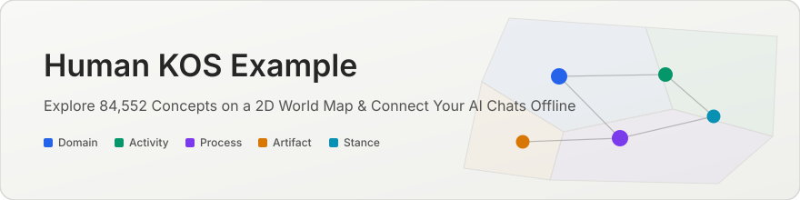
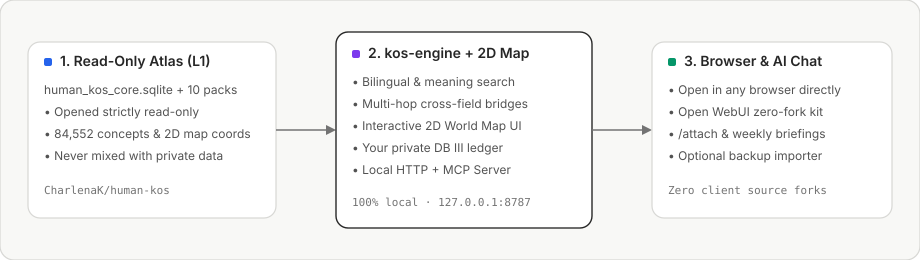

<div align="center">
  
</div>

<p align="center">
  <a href="./README.md"></a>
  <a href="./README_zh.md"></a>
</p>

<p align="center">
  
  
  
  
  <a href="./LICENSE/">
    
  </a>
</p>

<h4 align="center">
  <a href="#-get-started-in-3-minutes">Get Started</a> |
  <a href="#-what-you-can-do">Features</a> |
  <a href="#-documentation">Technical Docs</a> |
  <a href="./CONTRIBUTING.md">Contributing</a> |
  <a href="./LICENSE/">Licenses &amp; Credits</a>
</h4>

<div align="center" style="margin-top:16px;margin-bottom:16px;">
  
</div>

<details open>
<summary><b>📕 Table of Contents</b></summary>

- 💡 [What Is This Project?](#-what-is-this-project)
- ✨ [What You Can Do](#-what-you-can-do)
- 🚀 [Get Started in 3 Minutes](#-get-started-in-3-minutes)
- 🔌 [Connecting to Open WebUI (Optional)](#-connecting-to-open-webui-optional)
- 📚 [Documentation](#-documentation)
- 🤝 [Contributing](#-contributing)
- ⚖️ [Licenses &amp; Credits](#%EF%B8%8F-licenses--credits)

</details>

## 💡 What Is This Project?

This repository is the **official reference example** built on top of [**Human KOS**](https://github.com/CharlenaK/human-kos) — the offline, bilingual atlas of 84,552 human knowledge concepts.

Think of **Human KOS** as the shared world map, and **Human KOS Example** as a calm, local companion app that brings that map to life:

- **Open an interactive 2D Knowledge World Map** right in your browser — zoom smoothly from broad disciplines down to niche ideas, switch between Light and Dark themes, and explore cross-field connections.
- **Anchor your AI chats across five clear angles** — instead of burying conversations inside one flat folder, tag any chat across *Fields*, *Activities*, *Methods*, *Objects &amp; Eras*, and *Collaboration Stances*.
- **Discover unexpected links gently** — generate evidence-backed "Serendipity Briefings" from your own reading and chat history without sending your data to external servers or paid APIs.
- **Keep your personal history 100% private** — your personal mappings live in a separate local file on your own computer, never mixed into the shared read-only atlas.

> **Note:** This project is a clean reference implementation designed to stay lightweight and easy to adapt. You can use it as-is in your browser, connect it to **Open WebUI** without modifying a single line of Open WebUI's code, or plug the same local engine into your own favorite AI client.

---

## ✨ What You Can Do

### 🗺️ **Explore a Calm 2D Knowledge World Map**
Zoom and pan across 84,552 bilingual concepts colored by five clear dimensions. Click any concept to read its context, expand its cross-field bridges, or launch a fresh exploration prompt.

### 🧭 **Organize Chats Across Five Dimensions (`/attach`)**
Use the built-in Workbench tab (or type `/attach` inside Open WebUI) to pick matching concepts across five separate panels — eliminating ambiguous word mix-ups and letting dynamic topic collections emerge automatically.

### 🌱 **Receive Evidence-Backed Serendipity Briefings**
Instead of random AI guesswork, every suggested concept shows the exact path connecting it to your past discussions, along with clear source and license notices.

### 📥 **Optional Backup Import (Strictly On Your Terms)**
Includes a safe, preview-first importer for Open WebUI exports and Cherry Studio backup files. It **never** scans your computer automatically — it only reads a backup file when you explicitly point to it.

---

## 🚀 Get Started in 3 Minutes

No Docker, no cloud account, and no database server required.

### Step 1 — Download the Shared Knowledge Atlas

Download **`human_kos_core.sqlite`** (238 MB) from [**Human KOS Releases**](https://github.com/CharlenaK/human-kos/releases/latest).

Optionally, also download the `human_kos_ext/` folder (packs such as `unesco`, `lcsh`, `aat`) and keep it **next to** the core file — that is where the engine looks for extensions:

```text
my-kos-data/
├── human_kos_core.sqlite
└── human_kos_ext/          ← optional, auto-detected
    ├── unesco.sqlite
    └── ...
```

> Extensions must live in a folder literally named `human_kos_ext` beside the core database, or be passed explicitly with `--ext-dir`.

### Step 2 — Install `uv` (One-Time Setup)

If you don't have [`uv`](https://docs.astral.sh/uv/) (a fast Python runner) yet, install it in one line:

- **Windows (PowerShell)**: `irm https://astral.sh/uv/install.ps1 | iex`
- **macOS / Linux**: `curl -LsSf https://astral.sh/uv/install.sh | sh`

### Step 3 — Launch the App &amp; Open Your Browser

```bash
git clone https://github.com/CharlenaK/human-kos-example.git
cd human-kos-example/kos_engine
uv sync
uv run kos-engine --core /path/to/my-kos-data/human_kos_core.sqlite serve --port 8787
```

Now open **[`http://127.0.0.1:8787/map`](http://127.0.0.1:8787/map)** in your browser — you are exploring the 2D Knowledge World Map and Personal Workbench completely offline!

*(Optional: Want richer meaning-based search? Download the free `intfloat/multilingual-e5-small` ONNX model folder and pass `--model-dir /path/to/multilingual-e5-small`. Without it, fast keyword search still works automatically out of the box.)*

*(Docker note: if Open WebUI runs in a container, start the engine with `--host 0.0.0.0` so the container can reach it.)*

---

## 🔌 Connecting to Open WebUI (Optional)

Want to use `/attach`, the embedded 2D map tab, and scheduled weekly briefings directly inside **Open WebUI (`v0.13.4+`)**?

Because this kit connects purely through Open WebUI's official extension points (**MCP + MCP Apps + Python Functions + Automations**), you do **not** need to fork or rebuild Open WebUI. Follow the step-by-step setup guide in [`docs/OPEN_WEBUI_GUIDE.md`](./docs/OPEN_WEBUI_GUIDE.md).

In short: (1) run `kos-engine serve`; (2) run `kos-engine mcp --transport streamable-http --port 8788`; (3) add an **MCP Streamable HTTP** tool server and import the two Python functions in Open WebUI; (4) attach the tool server to a model so the assistant can open the map.

> Docker gotcha: when Open WebUI lives in a container, reach the engine at `host.docker.internal` and start the MCP server with `--allow-host host.docker.internal:8788`.

---

## 📚 Documentation

To keep this landing page clear and friendly, all technical specifications, design rules, and test reports live in [`docs/`](./docs/):

- [**Architecture &amp; Adapter Contract**](./docs/ARCHITECTURE.md) — Three-database isolation, hybrid search, multi-hop graph traversal, and HTTP / MCP API overview
- [**Open WebUI Integration Guide**](./docs/OPEN_WEBUI_GUIDE.md) — Step-by-step zero-fork setup for Filter, Action, MCP Apps, and scheduled briefings
- [**Design System &amp; Visual Rules**](./docs/design-rules/kos-design-system.md) — Calm grayscale palette, 5-facet identity colors, typography, radius rules, and automated token guard
- [**Verification &amp; Quality Report**](./docs/ACCEPTANCE.md) — Automated test suite, latency benchmarks, Bombadil UI property spec, and boundary checks

---

## 🤝 Contributing

Contributions are warmly welcome — whether you want to add a thin adapter for another AI client, improve the 2D map experience, polish translations, or report a UI bug!

Please read [**`CONTRIBUTING.md`**](./CONTRIBUTING.md) before opening a Pull Request. In short:

1. Keep the shared L1 Atlas strictly read-only and never commit personal chat logs or `.sqlite` files.
2. When editing UI styles, update [`docs/design-rules/tokens.dtcg.json`](./docs/design-rules/tokens.dtcg.json) and verify with `python docs/design-rules/tokens_guard.py --check`.
3. Run the automated test suite (`cd kos_engine && uv run pytest tests/ ../adapters/open_webui/tests/`) before submitting.

---

## ⚖️ Licenses &amp; Credits

- **This repository's code &amp; documentation**: [MIT License](./LICENSE/MIT.txt).
- **Visual Design System Inspiration**: Our visual language, three-tier calm grayscale palette, CJK-first typography stack, two-step corner-radius decision tree, single-source token workflow, and Light/Dark dual-mode delivery gate are gratefully inspired by the [**Cindy Design System**](https://github.com/makecindy/cindy/blob/main/docs/design-rules/cindy-design-system.md) (`makecindy/cindy`).
- **2D Graph Visualization Reference**: Our Sigma.js v4 + Graphology map setup draws architectural inspiration from [**ChatCrystal**](https://github.com/nicepkg/ChatCrystal) (Apache-2.0).
- **Full third-party notices &amp; upstream open-data license boundaries**: See [`LICENSE/README.md`](./LICENSE/README.md) and [`LICENSE/NOTICE.md`](./LICENSE/NOTICE.md).
