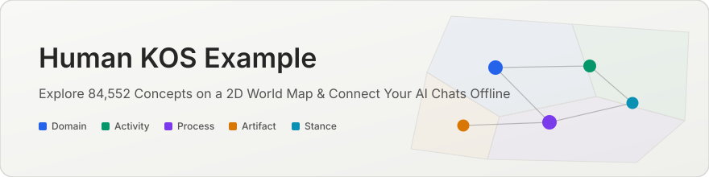
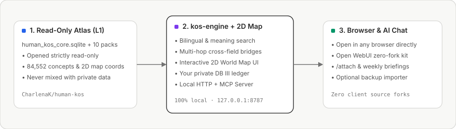

<div align="center">
  
</div>

<p align="center">
  <a href="./README.md"></a>
  <a href="./README_zh.md"></a>
</p>

<p align="center">
  
  
  
  
  <a href="./LICENSE/">
    
  </a>
</p>

<h4 align="center">
  <a href="#-%E4%B8%89%E5%88%86%E9%92%9F%E4%B8%8A%E6%89%8B">三分钟上手</a> |
  <a href="#-%E4%BD%A0%E5%8F%AF%E4%BB%A5%E7%94%A8%E5%AE%83%E5%81%9A%E4%BB%80%E4%B9%88">核心体验</a> |
  <a href="#-%E6%8A%80%E6%9C%AF%E6%96%87%E6%A1%A3">技术文档</a> |
  <a href="./CONTRIBUTING.md">如何贡献</a> |
  <a href="./LICENSE/">许可与致谢</a>
</h4>

<div align="center" style="margin-top:16px;margin-bottom:16px;">
  
</div>

<details open>
<summary><b>📕 目录</b></summary>

- 💡 [这是什么项目？](#-这是什么项目)
- ✨ [你可以用它做什么？](#-你可以用它做什么)
- 🚀 [三分钟上手（免 Docker）](#-三分钟上手免-docker)
- 🔌 [接入 Open WebUI（可选）](#-接入-open-webui可选)
- 📚 [技术文档](#-技术文档)
- 🤝 [如何参与贡献](#-如何参与贡献)
- ⚖️ [许可协议与致谢](#%EF%B8%8F-许可协议与致谢)

</details>

## 💡 这是什么项目？

本仓库是基于离线双语知识底座 [**Human KOS**](https://github.com/CharlenaK/human-kos)（84,552 个核心概念）打造的**官方参考示例应用**。

如果把 **Human KOS** 比作一张人人可用的“世界知识地图”，那么 **Human KOS Example** 就是让这张地图动起来的本地轻应用：

- **在浏览器里漫游二维知识地图**：从宏观学科一路放大到细分概念，自由切换浅色 / 深色模式，点击任意节点查看脉络与跨学科关联。
- **用五个清晰视角整理 AI 对话**：告别杂乱的聊天列表，把一段对话按*学科领域、人类活动、方法流程、器物时代、协作姿态*分别锚定，动态聚合成自己的专题集合。
- **有据可查的“受控漫游简报”**：根据你聊过的话题，沿着知识图谱里真实的跨学科桥梁为你发现意想不到的延伸方向——不瞎编、不联网、不花额外 API 费用。
- **你的个人记录永远留在自己电脑里**：个人映射账本保存在本地独立文件中，绝不污染共享只读图谱。

> **定位说明**：这是一个轻巧、克制的示例实现。你可以直接在浏览器里开箱体验，也可以零修改源码地接入 **Open WebUI**，或把同一套本地引擎接到你喜欢的其他 AI 工具中。

---

## ✨ 你可以用它做什么？

### 🗺️ **直观缩放的二维知识世界地图**
8.4 万个中英双语概念按五大维度清晰着色。支持平滑平移与最高 2,000 倍深度放大，中文标签清晰不乱码，点开节点即可查看定义、面包屑路径并一键发起新探索。

### 🧭 **五维对话锚定（`/attach`）与映射工作台**
在工作台里输入一段对话主题（或在 Open WebUI 中输入 `/attach`），五个维度分别给出候选概念，避免多义词互相串台；勾选确认后即写入你的本地个人账本。

### 🌱 **基于真实图谱路径的灵感简报**
每一条推荐延伸都附带清晰路径（例如“从逻辑推理经学术共现连向形式化验证”）以及完整的来源许可说明，帮你打破信息茧房。

### 📥 **安全、可控的历史备份导入**
提供面向 Open WebUI 导出文件与 Cherry Studio 备份的导入工具。工具**绝不会**擅自扫描你的电脑目录，只有在你主动指定备份文件路径时才会先预览（Dry-Run）、再由你决定是否导入。

---

## 🚀 三分钟上手（免 Docker）

不需要安装 Docker，不需要注册账号，也不需要配置云端服务。

### 第 1 步：下载知识图谱文件

前往 [**Human KOS Releases 页面**](https://github.com/CharlenaK/human-kos/releases/latest) 下载核心文件 **`human_kos_core.sqlite`**（约 238 MB）。

想用扩展包（`unesco`、`lcsh`、`aat` 等，用于把更多专业词汇接进来）的话，把 `human_kos_ext/` 整个文件夹也下载下来，和核心库放在一起：

```text
my-kos-data/
├── human_kos_core.sqlite
└── human_kos_ext/          ← 有就自动认，没有也能跑
    ├── unesco.sqlite
    └── ...
```

> 扩展包必须和核心库**在同一个文件夹**、文件夹名就叫 `human_kos_ext`；也可以用 `--ext-dir` 手动指定路径。

### 第 2 步：安装轻量工具 `uv`（仅首次需要）

如果你的电脑还没有 [`uv`](https://docs.astral.sh/uv/)（一个极快的 Python 运行工具），打开终端执行一行命令即可安装：

- **Windows（PowerShell）**：`irm https://astral.sh/uv/install.ps1 | iex`
- **macOS / Linux**：`curl -LsSf https://astral.sh/uv/install.sh | sh`

### 第 3 步：启动本地服务并打开地图

```bash
git clone https://github.com/CharlenaK/human-kos-example.git
cd human-kos-example/kos_engine
uv sync
uv run kos-engine --core <你的路径>/my-kos-data/human_kos_core.sqlite serve --port 8787
```

在浏览器打开 **[`http://127.0.0.1:8787/map`](http://127.0.0.1:8787/map)**，即可开始离线漫游二维知识地图与使用映射工作台。

> 小提示 1：地图顶部的「按需挂载」会列出你 `human_kos_ext/` 里的全部扩展包，点一下即挂载、再点一下卸载。
>
> 小提示 2：如果不额外下载语义向量模型，本应用会自动启用极速离线关键词检索（毫秒级响应）；若希望同时开启跨语言语义混合检索，可下载免费的 `intfloat/multilingual-e5-small` ONNX 模型并在启动时附加 `--model-dir <模型文件夹路径>`。
>
> 小提示 3：如果 Open WebUI 跑在 Docker 里，启动时加 `--host 0.0.0.0`，容器才连得进来（详见接入指南）。

---

## 🔌 接入 Open WebUI（可选）

如果你日常使用 **Open WebUI（`v0.13.4+`）**，可以直接把本仓库的薄接入套件加载进去，获得对话内 `/attach`、内嵌 2D 地图与定时漫游简报——全程**零修改 Open WebUI 源码**。

四步概览：

1. 起 `kos-engine`：`uv run kos-engine --core ... serve --port 8787`
2. 起 MCP 服务：`uv run kos-engine mcp --transport streamable-http --port 8788 ...`
3. 在 Open WebUI 里加一个「MCP 流式 HTTP」连接，再导入两个 Python 函数；
4. 把工具挂到模型上，就能在对话里开地图了。

> Docker 部署有一个坑：Open WebUI 在容器里，要用 `host.docker.internal` 才能访问你电脑上的 `kos-engine`，并且 MCP 服务启动时要加 `--allow-host host.docker.internal:8788`。

详细图文步骤（含每个地址该填什么、报错怎么修）见 [`docs/OPEN_WEBUI_GUIDE.md`](./docs/OPEN_WEBUI_GUIDE.md)。

---

## 📚 技术文档

为保证首页简洁易读，所有架构设计、接口契约、视觉规范与测试报告均收纳在 [`docs/`](./docs/) 目录中：

- [**系统架构与接口契约**](./docs/ARCHITECTURE.md) — 三库隔离、L2 适配器契约、轻量 ONNX 推理与本地 HTTP / MCP 接口说明
- [**Open WebUI 零改源码接入指南**](./docs/OPEN_WEBUI_GUIDE.md) — Filter / Action / MCP Apps 与 RRULE 定时简报配置手册
- [**视觉与设计系统规范**](./docs/design-rules/kos-design-system.md) — 三层灰度体系、五维分面身份色、排版/圆角规则与自动化 Token 守卫
- [**验收与质量测试报告**](./docs/ACCEPTANCE.md) — 自动化测试、检索延迟实测、Bombadil 属性化 UI 校验与边界扫描记录

---

## 🤝 如何参与贡献

非常欢迎任何形式的贡献——无论是为新的 AI 客户端补充薄接入壳、优化 2D 地图交互体验、完善多语言文案，还是反馈使用中的界面小问题！

提交前宜先阅读 [**`CONTRIBUTING.md`**](./CONTRIBUTING.md)，核心原则很简单：

1. **守住三库边界**：共享知识图谱保持只读，不把个人聊天记录或 `.sqlite` 大文件提交到代码仓。
2. **遵守设计规范**：修改界面样式时仅编辑 [`docs/design-rules/tokens.dtcg.json`](./docs/design-rules/tokens.dtcg.json)，并运行 `python docs/design-rules/tokens_guard.py --check` 确认零违规。
3. **提交前跑测试**：在 `kos_engine/` 目录下执行 `uv run pytest tests/ ../adapters/open_webui/tests/` 确保全绿。

---

## ⚖️ 许可协议与致谢

- **本仓库全部代码与文档**：采用 [MIT 许可协议](./LICENSE/MIT.txt)。
- **视觉表现与设计系统借鉴声明**：本项目的冷静纸感三层灰度、登记制语义色白名单、CJK 优先字体栈、两步圆角判定树、单源 Token 治理与亮暗双模式交付门槛，均参考借鉴了 [**Cindy Design System**](https://github.com/makecindy/cindy/blob/main/docs/design-rules/cindy-design-system.md)（`makecindy/cindy`），特此致谢并保留清晰溯源。
- **2D 图谱可视化技术参考**：Sigma.js v4 与 Graphology 渲染方案参考了 [**ChatCrystal**](https://github.com/nicepkg/ChatCrystal)（Apache-2.0）。
- **第三方组件许可与上游开放数据边界**：完整清单见 [`LICENSE/README.md`](./LICENSE/README.md) 与 [`LICENSE/NOTICE.md`](./LICENSE/NOTICE.md)。
